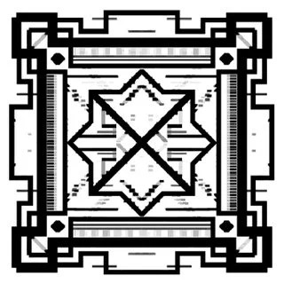
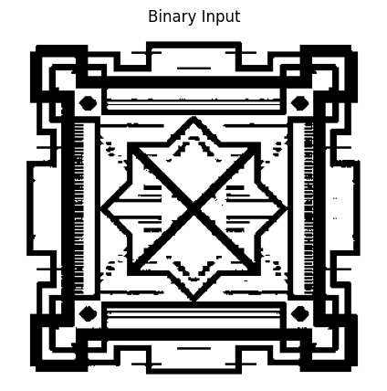
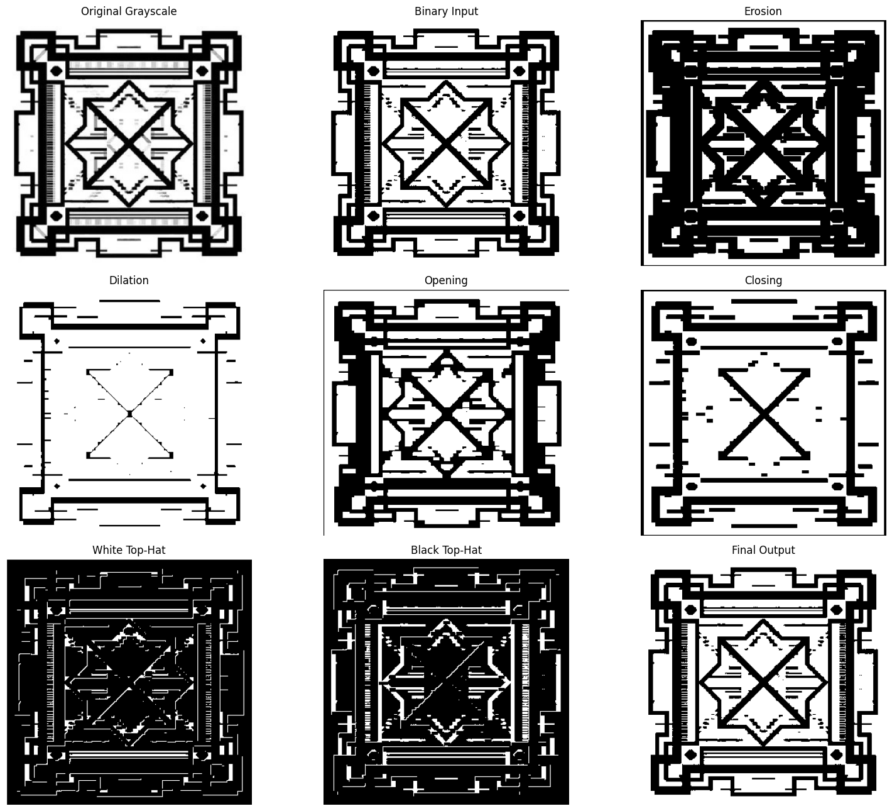
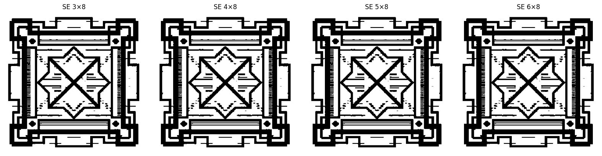

# Mathematical Morphological Image Processing

A custom Python implementation of **binary mathematical morphology** for image processing, based on the methodology presented in the reference paper:

> **A Study on Image Processing Using Mathematical Morphological**
> K. A. M. Said and A. B. Jambek, 2016 3rd International Conference on Electronic Design (ICED).

The project implements the main morphological operations from scratch and provides configurable image input, structuring-element comparison, quantitative verification, and optional grayscale morphology.

---

## Overview

Mathematical morphology is a nonlinear image-processing approach based on the interaction between an image and a **structuring element (SE)**.

The primary workflow implemented in this project is:

```text
Input Image
     ↓
Grayscale Conversion
     ↓
Binary Image
     ↓
Rectangular Structuring Element
     ↓
Erosion
     ↓
Dilation
     ↓
Opening
     ↓
Closing
     ↓
White Top-Hat
     ↓
Black Top-Hat
     ↓
Final Mathematical Morphological Output
     ↓
Structuring-Element Comparison
```

The primary processing mode is **binary mathematical morphology**, following the binary-image workflow of the reference paper.

---

## Implemented Operations

The notebook implements the following operations using custom functions:

* **Erosion**
* **Dilation**
* **Opening**
* **Closing**
* **White Top-Hat (WTH)**
* **Black Top-Hat (BTH)**
* **Final morphological recombination**

The mathematical definitions are:

```text
Opening = Erosion → Dilation

Closing = Dilation → Erosion

White Top-Hat = Input − Opening

Black Top-Hat = Closing − Input

Final Output = Input + White Top-Hat − Black Top-Hat
```

For binary input, the final recombination can reconstruct the original binary image. Therefore, the intermediate morphological outputs are important for observing the structural effects of the selected structuring element.

---

## Custom Implementation

The core morphological operations are implemented directly using custom Python logic.

The implementation does **not** use built-in morphology functions such as:

```text
cv2.erode()
cv2.dilate()
cv2.morphologyEx()
scipy.ndimage binary morphology
skimage.morphology
```

The core erosion and dilation implementation also does not rely on:

```text
numpy.lib.stride_tricks.sliding_window_view
numpy.einsum
```

This provides direct control over the structuring-element positions, pixel operations, and morphological transformations.

---

## Structuring Element

The reference-oriented configuration uses a rectangular:

```text
4 × 8
```

structuring element.

The notebook also evaluates:

```text
3 × 8
4 × 8
5 × 8
6 × 8
```

to observe how different SE dimensions affect the morphological results.

An additional **adaptive SE mode** is available for processing images with different resolutions. The adaptive configuration maintains approximately the same `1:2` height-to-width relationship while applying practical size bounds.

The fixed `4 × 8` configuration remains the primary paper-oriented setting.

---

## Input Handling

The notebook accepts an image selected at runtime rather than depending on a fixed filename.

Supported formats include:

* JPG / JPEG
* PNG
* BMP
* TIFF / TIF
* WEBP

The implementation can be used in:

* Google Colab
* Jupyter Notebook
* Local Python environments

For Colab, an image can be uploaded directly through the notebook.

For local execution, an image path can be supplied through the input configuration.

---

## Otsu Thresholding

The binary processing workflow includes a **custom Otsu thresholding implementation**.

The threshold is calculated from the image histogram rather than relying on OpenCV's thresholding function.

This step converts the grayscale input into the binary representation required by the primary morphology workflow.

---

## Processing Modes

### Binary Mode

The primary configuration is:

```python
PROCESSING_MODE = "binary"
SE_MODE = "paper"
PAPER_SE = (4, 8)
```

This configuration is intended for reproduction of the primary reference-oriented experiment.

### Grayscale Extension

The notebook also provides an optional grayscale morphology mode.

In grayscale morphology:

```text
Erosion  → minimum intensity over active SE positions
Dilation → maximum intensity over active SE positions
```

This preserves intensity information that is discarded during binary thresholding.

The grayscale mode is an **engineering extension** and is kept separate from the primary binary paper-reproduction experiment.

---

## Results

### Input Image



### Otsu Thresholding



### Morphological Processing Results

The final results visualization includes the major stages of the processing pipeline, including:

* Original image
* Binary input
* Erosion
* Dilation
* Opening
* Closing
* White Top-Hat
* Black Top-Hat
* Final output



### Structuring Element Comparison

The notebook also compares the results obtained using different rectangular structuring elements.



---

## Verification

The notebook includes quantitative sanity checks to verify the consistency of the custom implementation.

The verification includes checks for:

* Binary final recombination
* Opening consistency
* Closing consistency
* Pixel-level mismatch
* Mismatch rate
* Maximum difference

These checks provide an additional verification layer for the custom implementation.

---

## Repository Contents

```text
mathematical-morphology-image-processing/
│
├── Mathematical_Morphology_Image_Processing.ipynb
│   └── Complete implementation and experiments
│
├── Mathematical_Morphology_Image_Processing_Report.pdf
│   └── Technical report
│
├── Input_image.jpg
│   └── Example input image
│
├── Otsu_thresholding.png
│   └── Binary thresholding result
│
├── Final_results.png
│   └── Main morphological processing results
│
├── Comparison.png
│   └── Structuring-element comparison
│
└── README.md
    └── Project documentation
```

---

## Reproducibility

To reproduce the primary reference-oriented configuration:

```python
PROCESSING_MODE = "binary"
SE_MODE = "paper"
PAPER_SE = (4, 8)
```

The notebook is designed so that the input image can be changed without modifying the core morphological implementation.

---

## Reference

K. A. M. Said and A. B. Jambek,
**“A Study on Image Processing Using Mathematical Morphological,”**
*2016 3rd International Conference on Electronic Design (ICED)*,
Phuket, Thailand, 11–12 August 2016.

### Key Equations

```text
Final Mathematical Morphological Output = IM + WTH − BTH

WTH = IM − Opening

BTH = Closing − IM

Opening = IM ⊖ SE ⊕ SE

Closing = IM ⊕ SE ⊖ SE
```

The reference experiment uses rectangular structuring elements and evaluates different SE configurations for its specific input image.

---

## Project Scope

This repository separates the **reference-paper implementation** from additional engineering functionality.

### Reference-oriented implementation

* Binary mathematical morphology
* Rectangular structuring element
* Erosion
* Dilation
* Opening
* Closing
* White Top-Hat
* Black Top-Hat
* Final morphological recombination
* `4 × 8` paper-oriented SE
* SE comparison

### Additional implementation features

* Dynamic image input
* Custom grayscale conversion
* Custom Otsu thresholding
* Adaptive SE selection
* Optional grayscale morphology
* Quantitative verification
* Reusable image-resolution handling

The additional features are implementation extensions and are not presented as methods used by the original 2016 reference paper.

### License
This project is open-source software licensed under the **MIT License**. You are free to use, modify, share, and contribute to this repository for educational, professional, and personal portfolio applications. Please review the LICENSE file for details.
